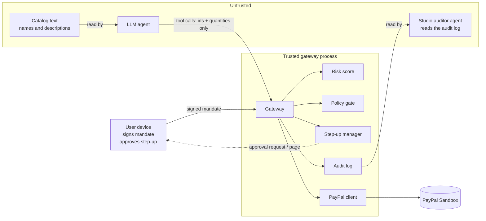
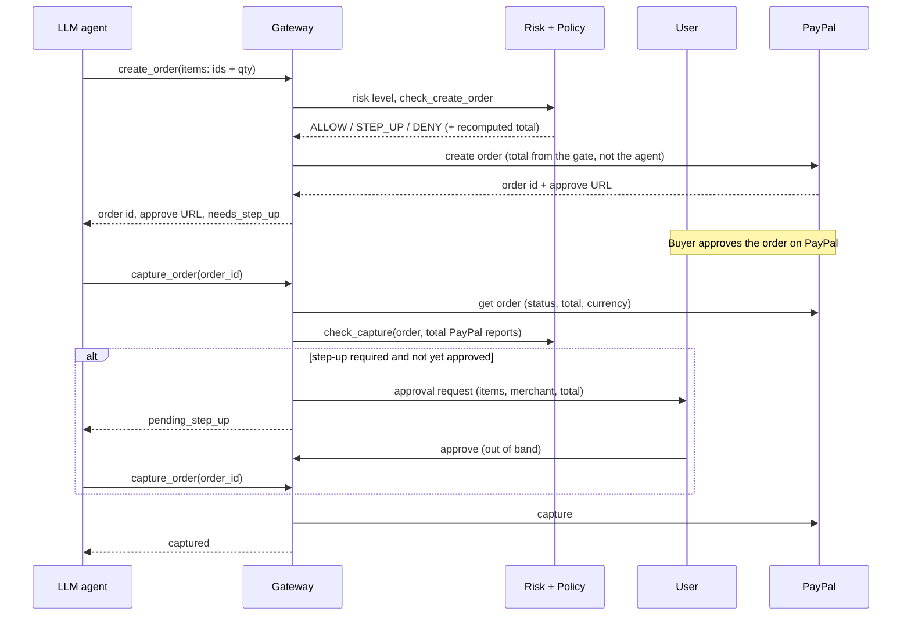

# Architecture

## Core rule

> Every financial action passes through one deterministic gateway before it can reach PayPal.

The LLM is treated as **untrusted**. It can be manipulated by anything it reads. So it is given the smallest possible vocabulary: it names *item ids and quantities*. Everything that determines money (price, merchant, total, limit, approval) is decided by code it cannot influence.

## Trust zones



What is trusted for what:

| Data | Source | Trust |
|---|---|---|
| Spending limit, merchants, expiry | Signed mandate | Trusted once the signature, expiry, session and nonce check out |
| Price, merchant, currency of an item | Server-side snapshot of an offer the agent was shown (Channel3 or static catalog) | Trusted by the gate, for 15 minutes; Channel3's accuracy is itself trusted |
| Names, descriptions and images | Catalog (merchant written) | **Untrusted**: shown to the LLM and scanned by the risk score, never used for a decision. Names and images are also displayed to the user on the approval page, escaped, with https images only; the merchant, price, quantity and total shown there come from the gateway's own snapshot. |
| Item ids, quantities | LLM | Untrusted input, validated |
| Final total | Recomputed by the gate, then read back from PayPal at capture | Trusted |
| Step-up approval | User's out-of-band channel | Trusted; the agent has no tool to reach it |
| Studio chat agent's output | A second LLM that reads the audit log | **Untrusted**: it can write or mislead a dashboard widget, but has no tool that approves, denies, pays or edits a mandate |

## Components

| File | Responsibility |
|---|---|
| `mandate.py` | Ed25519-signed, canonical-JSON mandates. `MandateVerifier.verify` checks signature, expiry, clock skew (30 s), session binding and single-use nonce. |
| `policy.py` | `PolicyGate.check_create_order` and `check_capture`. Returns `ALLOW`, `STEP_UP` or `DENY` with a reason. Tracks recorded orders and cumulative captured spend. |
| `catalog.py` | `Channel3Catalog` (calls `/v1/search`, keeps up to 3 cheapest in-stock offers per product in the mandate currency, item id `<product_id>@<domain>`, snapshot with TTL) and `StaticCatalog` for the offline demos. `.get(item_id)` is what the gate trusts. |
| `risk.py` | `RiskEngine`: cumulative session risk (below). |
| `semantic.py` | `IntentTracker` compares each item name with the user's own messages by cosine similarity (floor 0.30) and returns a drift score in [0, 1]. `MiniLM` is the real embedder (sentence-transformers, all-MiniLM-L6-v2); `ToyEmbedder` is a word-overlap stand-in for the offline demos and tests. It only feeds the risk score; the gate still decides. |
| `stepup.py` | `StepUpManager` (request, approve, deny, expiry; single decision) plus a localhost-only approval page that shows what is being approved: items with pictures, merchant, prices, quantities, total and the reason. |
| `audit.py` | Append-only JSONL, each entry carries the SHA-256 of the previous one. `verify_log` detects edits and deletions. |
| `paypal_client.py` | Orders v2: create (optionally saving the buyer's PayPal), get, capture, and `charge_saved` for auto-pay. Sandbox URL only. Idempotency keys. Errors carry PayPal's `debug_id`. |
| `gateway.py` | Orchestrates the above. The only thing the agent can call. Builds the step-up line items from its own catalog snapshot. |
| `agent.py` | Model-agnostic tool-calling loop and the Groq adapter. |
| `dashboard/llm_proxy.py` | Relay for the Studio chat panel's model calls (`POST /api/llm`). Off unless `LLM_API_KEY` is set; localhost only, Host and Origin must match, `/responses` and `/chat/completions` only, 2 MB body cap, provider key added server-side. |

## Request flow



Order of checks in `create_order`: risk `block` (read-only mode) first, then the policy gate, then escalation of `ALLOW` to `STEP_UP` if risk is at `warn`, then the PayPal call.

Order of checks in `capture_order`: risk `block`, known order, PayPal status is `APPROVED`, currency matches, step-up status, policy gate (total unchanged, within limit, not already captured), escalation under `warn`, then capture. Spend is only counted once PayPal reports the capture `COMPLETED`.

## Auto-pay mode

With a saved PayPal (`vault_token` given to the gateway), `create_order` pays immediately: PayPal charges the saved account when an order is created with the payment token. So the order of checks moves earlier:

1. risk `block` (read-only), then the policy gate, then escalation of `ALLOW` to `STEP_UP` at risk `warn`;
2. if `STEP_UP`: a request is sent to the user's out-of-band channel and **nothing is charged**; the agent calls `create_order` again with the same items after approval, and the approval pays exactly once;
3. only then `charge_saved`; PayPal's response is checked (status `COMPLETED`, total and currency equal to what the gate computed), the spend is booked from what actually left the account, and a mismatch is logged as `charge_mismatch`.

The capture tool is removed from the agent's tool list, and the gateway refuses it. The token is a standing credential held by the gateway only. Identical orders in a session reuse one PayPal request id, so a repeat is reported as a duplicate instead of charged twice.

## Mandates

```json
{
  "mandate": {
    "user_id": "alice", "session_id": "s-100", "nonce": "…",
    "issued_at": 1790000000, "expires_at": 1790000600,
    "max_total": "100.00", "currency": "USD",
    "allowed_merchants": ["shop-a"]
  },
  "signature": "<base64 Ed25519 over canonical JSON>"
}
```

The signing key stays on the user's side. The gateway holds only the public key registered for that user. Amounts are decimal strings, never floats.

## Cumulative risk score

```
r_t = γ · r_(t-1) + S_turn(t) + S_drift(t) + S_sem(t)
```

- `S_turn` (0 to 1): 0.5 per distinct injection-phrase pattern found in untrusted text shown to the agent, capped at 1.
- `S_drift` (0 to 1): `max(0, attempted/limit − 0.5) × 2`, plus 0.5 if the action was denied, capped at 1.
- `S_sem` (0 to 1): semantic drift from `semantic.py`: 0 when the item name resembles something the user asked for (cosine similarity at or above a floor, default 0.30), rising to 1 at half the floor. Added when an order is created.
- `γ = 0.8`. Level `warn` at `r ≥ 1.0` (all approvals become user-confirmed), `block` at `r ≥ 2.5` (read-only: searches still work, orders and captures are refused).

These constants are placeholders to be tuned (see [experiments.md](experiments.md)). With constant input `s` per update, `r` converges to `s / (1 − γ)`, which equals `5 · s` for `γ = 0.8`. In the multi-turn demo (`s = 0.5`) that is exactly 2.5, the `block` threshold, so persistent weak signals reach `warn` but never cross `block` there. A stronger constant signal (above 0.5 per turn) would.

## Step-up approval

`StepUpManager.request` issues an unguessable id (UUID4) with a 300 s expiry and calls an optional `notify` callback (the hook for a push notification or webhook). `serve()` exposes a localhost page: `GET /r/<id>` shows the request, `POST /approve/<id>` and `/deny/<id>` decide it. Each request accepts exactly one decision. The agent's tool set contains no function that reaches `approve` or `deny`. A request can carry line items (name, merchant, price, currency, quantity, image) that the gateway builds from its catalog snapshot at order time, never from the agent. The page escapes all merchant-written text, accepts only `https://` images (anything else becomes a letter placeholder), loads images with `no-referrer`, and sends headers that forbid framing and restrict images to https, so another page cannot trick the user into clicking Approve.

## Dashboard

`dashboard/server.py` (standard library only, localhost only) serves a static page and `GET /api/logs`. It is read-only apart from one optional route, `POST /api/llm`, which relays the Studio chat panel's model calls (see below). `/` opens the Studio build when it exists; `/?classic=1` serves the plain dashboard. The page polls every 2 seconds and sends the file name it already holds plus the last event number it has, so the server returns only new events; a different file (a new session) is sent in full. A half-written last line is ignored, and the response includes whether the hash chain verifies. Rendering uses AG Grid Community and AG Charts Community (vendored, MIT); all log text is written with `textContent`, never HTML, because the log can contain untrusted product text. The gateway logs a `search_results` event for each search (item ids, names, merchants, prices and the product image URL), so the dashboard can show what the agent saw; image URLs are never sent to the model. If the user has installed AG Grid Enterprise locally (`python -m dashboard.get_enterprise`), `/api/config` tells the page to load it and passes the license key from `.env`; the enterprise bundle is git-ignored because it is not redistributable.

### AG Studio front end

`studio/` is a React + Vite app on AG Studio. `src/logs.ts` polls `/api/logs`, keeps the events and the list of audit files in a small store (a **Session** dropdown in the top bar switches between files, or follows the newest); `src/tables.ts` turns them into six tables (events, gate decisions, payments, risk, products seen, summary) that `src/data.ts` hands to Studio's data engine with explicit field formats. `src/state.ts` is the pre-built report (two pages on a 24-track grid) that references fields as `<table>.<field>`. Three custom widgets in `src/widgets.tsx` (risk gate, product gallery, approval queue) read the same live store, so they update with the built-in widgets. The built app is served by the Python server at `/studio/`; the license key comes from `/api/config`.

**Agent Framework.** `src/ai.ts` configures Studio's chat panel: the five built-in agents (Lead, Planning, Data, Page, Widget) plus a custom `auditor` agent with read-only data tools that can answer questions about the audit tables and add widgets Its tool set is the read tools plus `addWidget`; nothing in it reaches approvals, payments or the mandate. The model call goes through `dashboard/llm_proxy.py` (`POST /api/llm`), which adds the provider key server-side, accepts only `/responses` and `/chat/completions`, requires a matching Host and Origin, caps the body at 2 MB, and is off unless `LLM_API_KEY` is set. The auditor reads the same audit log that contains untrusted product text, so its instructions treat table text as data; the control that matters is the missing tools, not the instruction.

## Audit log

One JSON object per line: `ts`, `event`, `data`, `prev`, `hash`. Events: `session_start`, `user_message`, `tool_call`, `decision` (verdict, reason, total, risk, semantic drift, session id), `step_up_requested`, `step_up_resolved`, `captured`, `paypal_error`, `catalog_error`, `charge_mismatch`. Writes are serialized with a lock, because the approval page logs from its own thread. It is designed to double as research data: every blocked attempt is recorded with the risk score at that moment.

## Design decisions

- **Recompute, don't trust.** Rather than tracking the provenance of every string, the gate removes the need: the agent supplies only ids and quantities, so injected text has nothing numeric or monetary to alter.
- **Two checkpoints.** Creating a PayPal order is not paying. The gate runs before creation and again before capture against PayPal's own figures, which closes the window for the order changing in between.
- **Deterministic enforcement, probabilistic detection.** The gate decides. The risk score only *escalates* (to user approval or read-only), so a missed detection degrades to "the gate still holds", not "money moves".
- **Snapshot, don't look up.** Purchasable items are exactly the offers the agent was shown, frozen at search time. A made-up id, a different merchant or a stale price all fail as "unknown item", and the agent must search again.
- **Idempotency.** The create request id is derived from the mandate nonce and the item list, so a retried identical order reuses the same PayPal order. Capture ids are derived from the order id.
- **Model-agnostic.** One function boundary to the LLM, so models can be swapped and compared under the same attacks.

## Production design (not implemented in this prototype)

| Prototype | Production |
|---|---|
| Gateway and agent share a process | Gateway holds PayPal credentials inside a TEE with remote attestation; credentials released only to a binary with a known measurement |
| `dict` of public keys | Key registration, rotation and revocation; hardware-backed user keys (passkeys) |
| In-memory nonce set | Durable nonce store shared across gateway instances |
| Localhost approval page (shows items, merchant and total; no login) | Push notification with WebAuthn confirmation |
| Fixed phrase list | Learned or ensemble scoring, evaluated against a benchmark |
| Audit file on disk | Head hash anchored externally, so rewriting the whole chain is detectable |
